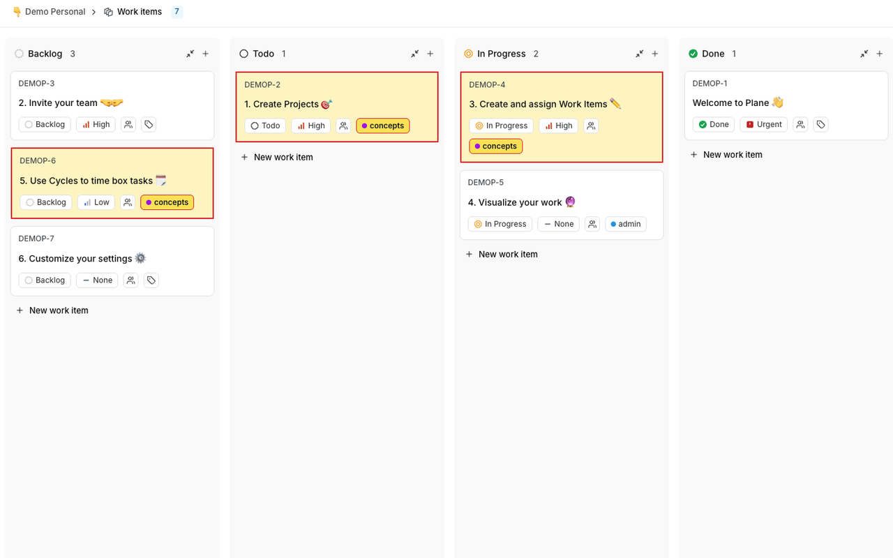
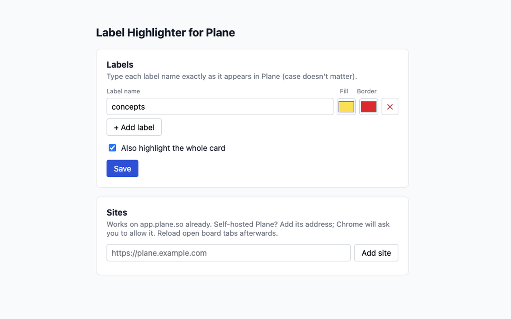

# Label Highlighter for Plane

A Chrome extension that highlights the labels you choose on [Plane](https://plane.so) boards, and can tint the whole card that carries them.



## Features

- Pick label names, each with its own fill and border color
- Optionally highlight the entire card, not just the label chip
- Works on `app.plane.so` out of the box
- Self-hosted Plane: add your site's address in settings and allow it when Chrome asks
- Changes apply instantly to open boards
- No account, no tracking: settings live in your Chrome profile (`chrome.storage.sync`)

## Install

**From source:**
1. Clone this repo
2. Open `chrome://extensions` and turn on **Developer mode**
3. Click **Load unpacked** and select the repo folder

## Usage

Click the extension's toolbar icon to open settings.



1. Type a label name exactly as it appears in Plane (case doesn't matter) and pick colors
2. Tick **Also highlight the whole card** if you want the card tinted too
3. Click **Save**
4. Self-hosted Plane only: add your site under **Sites**, then reload the board tab

## How it works

- `highlight.js` scans the board for label chips whose text matches your list and adds highlight classes; it rescans when the board re-renders.
- `background.js` registers the same script on self-hosted sites you've allowed (optional host permissions, requested one site at a time).
- `options.html` / `options.js` is the settings page.

## Package for the Chrome Web Store

```sh
mkdir -p dist && zip -r -X dist/label-highlighter-for-plane-$(jq -r .version manifest.json).zip \
  manifest.json background.js defaults.js highlight.js highlight.css options.html options.js icons
```

Store images live in `store/`.

## Privacy

The extension reads label text on Plane pages only to decide what to color. It collects nothing and sends nothing anywhere.

## License

[MIT](LICENSE)

---

Not affiliated with or endorsed by Plane.
